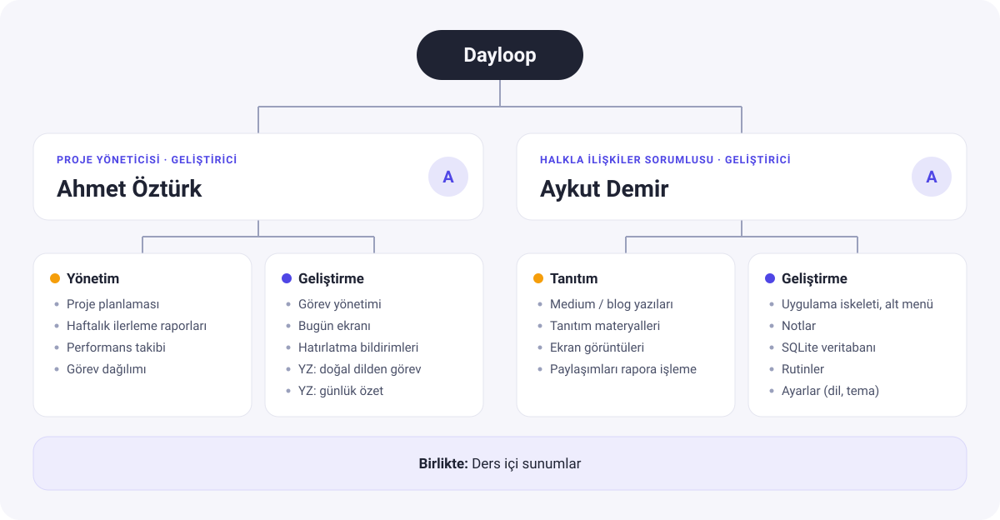

# Dayloop – Kapsam ve İş Planı

- **Ders:** Mobile Programming – İstanbul Üniversitesi Cerrahpaşa
- **Proje yöneticisi:** Ahmet Öztürk
- **Ekip:** Ahmet Öztürk, Aykut Demir
- **Repo:** <https://github.com/ahmetzturk/dayloop>
- **Güncelleme:** 19 Ekim 2026

## 1. Amaç

Gün içinde yapılacak işler; kâğıt notlara, mesajlaşma uygulamalarına ve akılda tutulan listelere dağılınca kolayca unutulur. **Dayloop**, kişinin günlük işlerini tek bir yerde toplayan, zamanı geldiğinde hatırlatan ve tekrar eden rutinlerini adım adım yürütmesine yardım eden **yapay zeka destekli bir kişisel sekreter** uygulamasıdır.

Uygulamanın ayırt edici özelliği, kullanıcının görev eklemek için form doldurmak zorunda kalmamasıdır: *"Yarın saat 10'da dişçi randevum var"* gibi bir cümle yazması yeterlidir. Yapay zeka bu cümleden başlık, tarih ve saat bilgisini çıkararak görevi oluşturur.

## 2. Hedef Kullanıcı

- Ders, iş ve kişisel işlerini birlikte yönetmeye çalışan öğrenciler ve çalışanlar
- Günlük rutinlerini (sabah rutini, spor, ders çalışma vb.) düzenli takip etmek isteyenler

## 3. Kapsam

### Temel özellikler

İlk olarak bu özellikler geliştirilecek:

- **Görev yönetimi:** Görev ekleme, düzenleme, silme ve tamamlandı olarak işaretleme. Her görevin başlığı, açıklaması, tarihi ve saati olur.
- **Bugün ekranı:** Uygulama açıldığında günün görevlerini ve ilerlemeyi gösteren ana ekran.
- **Notlar:** Başlık ve içerikten oluşan basit notlar.
- **Hatırlatma bildirimi:** Saati gelen görev için telefon bildirimi.
- **Yerel veri saklama:** Tüm veriler cihazda **SQLite** veritabanında saklanır, internet olmadan çalışır.
- **Gezinme:** Alt menü ile ekranlar arası geçiş (Bugün, Görevler, Notlar, Rutinler, Ayarlar).

### Ek özellikler

Temel özellikler tamamlandıktan sonra eklenecek:

- **Doğal dilden görev oluşturma (YZ):** Yazılan cümleden görevin otomatik oluşturulması.
- **Günlük özet (YZ):** Günün görevlerinden kısa bir özet (ör. "Bugün 5 işin var, 2'si gecikmiş").
- **Rutinler:** Tekrar eden işler için adım adım kontrol listesi (ör. Sabah rutini: su iç → spor → e-posta kontrol).
- **Ayarlar:** Türkçe / İngilizce dil seçimi, açık / koyu tema.

### Zaman kalırsa

- Firebase ile kullanıcı girişi ve bulut yedekleme
- Google Play Store'da yayın

### Kapsam dışı

- Serbest sohbet eden bir sohbet botu
- Google Takvim vb. harici takvimlerle eşitleme
- Sesli komut
- Kullanıcılar arasında görev paylaşımı

## 4. Teknolojiler

- **Flutter 3.47.7 / Dart 3.13.5:** Derste işlenen teknoloji.
- **Android:** Hedef platform; emülatörde ve gerçek cihazda test.
- **SQLite:** Cihazda yerel veritabanı, internetsiz çalışma.
- **Google Gemini (Firebase üzerinden):** Yapay zeka özellikleri için. API anahtarı uygulamanın içinde tutulmaz.
- **Git + GitHub:** Sürüm kontrolü, ekip çalışması ve katkı takibi.

Kullanılacak Flutter paketleri, ilgili özelliğe başlanırken belirlenip bu dokümana eklenecek.

## 5. Veri Modeli (Taslak)

- **Görev:** başlık, açıklama, tarih ve saat, hatırlatma açık mı, tamamlandı mı
- **Not:** başlık, içerik, son güncelleme tarihi
- **Rutin:** ad
- **Rutin adımı:** hangi rutine ait olduğu, adım metni, sırası

## 6. Ekip ve Organizasyon

### Organizasyon şeması

### Ahmet Öztürk – Proje Yöneticisi, Geliştirici

- Proje planlaması ve takibi
- Haftalık ilerleme raporları
- Ekip üyelerinin performans kaydı
- **Geliştirme:** Görev yönetimi, Bugün ekranı, hatırlatma bildirimleri, YZ özellikleri (doğal dilden görev, günlük özet)

### Aykut Demir – Halkla İlişkiler Sorumlusu, Geliştirici

- Medium / blog tanıtım paylaşımları
- Ekran görüntüleri ve tanıtım materyalleri
- Paylaşımların haftalık rapora eklenmesi
- **Geliştirme:** Uygulama iskeleti ve alt menü, Notlar, SQLite veritabanı, Rutinler, Ayarlar

İşler **özellik bazında** dağıtıldı: her üye kendi özelliğinin ekranını, verisini ve mantığını baştan sona yazar. Böylece iki üye de kodun tamamına hakim olur ve katkılar dengeli olur.

### Çalışma kuralları

- Kod değişiklikleri `main` dalına doğrudan atılmaz: her özellik ayrı bir dalda yapılır, **Pull Request** ile birleştirilir. Yalnızca doküman değişiklikleri doğrudan `main`'e atılabilir.
- Kod içindeki adlar İngilizce, arayüz metinleri Türkçe / İngilizce, commit mesajları Türkçe.
- Herkes kendi GitHub hesabından commit atar.
- Proje yöneticisi her hafta [performans takibini](performans-takibi.md) ve [haftalık raporu](haftalik-raporlar/) günceller.

## 7. İş Planı

Haftalar dersin haftalarıdır.

### Hafta 5 – Hazırlık

- Ahmet: Geliştirme ortamı, GitHub reposu, kapsam dokümanı, ekran taslakları
- Aykut: Geliştirme ortamı, tanıtım kanalının açılması

### Hafta 6 – İlk sunum

- Ahmet: Görev ekleme ve listeleme ekranları
- Aykut: Uygulama iskeleti ve alt menü
- Birlikte: İlk sunum

### Hafta 7

- Ahmet: Bugün ekranı
- Aykut: SQLite veritabanı altyapısı, görevlerin kaydedilmesi

### Hafta 8

- Ahmet: Hatırlatma bildirimleri
- Aykut: Notlar

### Hafta 9–10

- Ahmet: Doğal dilden görev oluşturma, günlük özet (YZ)
- Aykut: Rutinler

### Hafta 11–12

- Ahmet: Hata düzeltmeleri, testler
- Aykut: Ayarlar (dil, tema)

### Hafta 13–14 – Teslim hazırlığı

- Ahmet: Proje raporu
- Aykut: Tanıtım videosu
- Birlikte: Zaman kalırsa bulut yedekleme, son düzenlemeler

**Her hafta:** ilerleme raporu (Ahmet), en az bir tanıtım paylaşımı (Aykut), performans takibinin güncellenmesi (Ahmet).

## 8. Riskler ve Önlemler

- **Ekibin Dart / Flutter'a yeni olması:** Özellikler sade tutulur, ders konularıyla paralel ilerlenir, temel özellikler önce bitirilir.
- **Android bildirim izinlerinin karmaşıklığı:** Bildirim özelliğine erken başlanır.
- **YZ servisinde kota veya erişim sorunu:** Uygulama YZ olmadan da tam çalışır; YZ yalnızca kolaylık sağlar.
- **API anahtarının public repoda açığa çıkması:** Anahtar uygulamada tutulmaz, gizli dosyalar `.gitignore` ile dışarıda bırakılır.
- **Bir üyenin aksaması:** Haftalık takip yapılır, gerekirse işler yeniden dağıtılır.
